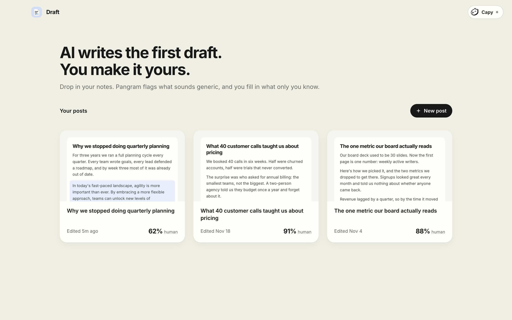

# Draft

**AI writes the first draft. You make it yours.**

Draft is a desktop app for writing blog posts with an AI agent without ending up with generic AI prose. Your agent writes the first draft from your notes over MCP, [Pangram](https://www.pangram.com) scores every paragraph, and the ones that read as AI-written get a question only you can answer: an example, a number, an opinion. Your answers get worked back in until the post sounds like you. Export to Markdown, Word or PDF when it's done.



## Install and open the app

Requires macOS and Node.js 22.18 or newer.

```bash
git clone https://github.com/amagomori/draft-two.git
cd draft-two
npm install
cp .env.example .env   # add your PANGRAM_API_KEY
npm start
```

`npm run seed` adds three sample posts. Without a Pangram key, the app runs on clearly labelled demo scores.

To build a standalone app, run `npm run package`. The `.dmg` and `Draft.app` land in `apps/desktop/dist/`.

## Connect an agent over MCP

Each post has its own MCP connection. Open a post, click the **Capy** chip in the top bar and copy the command. It looks like this:

```bash
node /path/to/draft-two/mcp/src/index.ts --post 1
```

**Capy:** in Settings → MCP & plugins, add an MCP server with transport **STDIO**, key `draft`, command `node` and arguments `/path/to/draft-two/mcp/src/index.ts`, `--post`, `1`. Run the thread on the Mac where Draft is installed, then ask Capy to write and humanize the post.

**Claude Code and other clients:**

```json
{
  "mcpServers": {
    "draft": {
      "command": "node",
      "args": ["/path/to/draft-two/mcp/src/index.ts", "--post", "1"]
    }
  }
}
```

The Capy chip turns green while an agent is connected, and the editor updates live as the agent works.

| Tool | What it does |
| - | - |
| `get_post` | Reads the notes, paragraphs, Pangram scores, questions and your answers |
| `write_draft` | Writes the first draft from your notes |
| `score_post` | Scores the post with Pangram and flags AI-sounding paragraphs |
| `ask_question` | Asks you one specific question about a flagged paragraph |
| `update_paragraph` | Works your answer into a paragraph |
| `insert_paragraph`, `delete_paragraph`, `set_title` | Edits the post |
| `export_post` | Exports Markdown, Word or PDF |
